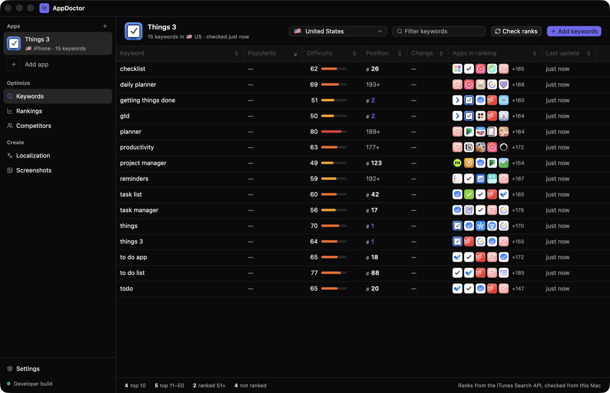

# AppDoctor desktop

The native AppDoctor app for macOS and Windows: Rust, [GPUI](https://www.gpui.rs/)
and [gpui-kit](https://gpui-kit.com) (gpui-component). No webview. Keyword data,
rank history and credentials never leave the machine.



## Running it

```sh
cargo run -p appdoctor-desktop --features no-license-check
```

`rust-toolchain.toml` pins Rust 1.99.1 (gpui-kit 0.8.1's gpui snapshot needs
std APIs newer than 1.96), and rustup installs it on first use. The first build
compiles gpui's whole tree; after that, an edit rebuilds only the app crate, which
builds at `opt-level = 0` and incrementally while dependencies build at
`opt-level = 2`, as in Cap's desktop-gpui.

- `no-license-check`: for contributors. Every feature works without an
  AppDoctor account. Official installers are built without it.
- `cargo test`: unit tests for App Store parsing, throttling, scoring, the
  store, both Apple JWTs and entitlement verification. The UI has no tests yet.
- `apps/desktop/scripts/bundle-dev.sh --features no-license-check` (macOS)
  wraps the debug binary in `target/debug/AppDoctor.app`. Use it when the app
  needs a bundle identity: accessibility and automation, keychain prompts that
  say "AppDoctor", or the Dock.

Environment variables:

| Variable | Effect |
|---|---|
| `APPDOCTOR_DATA_DIR` | Data folder. Default: `~/Library/Application Support/AppDoctor` on macOS, `%APPDATA%\AppDoctor` on Windows |
| `APPDOCTOR_EPHEMERAL_SECRETS=1` | Keep secrets in memory, not the keychain. An unsigned rebuild changes the binary's identity, so macOS asks again for keychain access every time |
| `APPDOCTOR_ENTITLEMENT_PUBLIC_KEY` | Debug builds only: verify licences against this key, e.g. a local API's dev key pair |
| `RUST_LOG` | e.g. `appdoctor=debug` |

## Architecture

```text
Cargo.toml              one workspace; the npm/turbo side of the repo never touches it
apps/desktop            the `appdoctor` binary: GPUI window, views, app state
crates/appstore         App Store–native search (MZStore), iTunes Lookup/Search fallback, URL parsing, storefronts, throttle
crates/store            SQLite (WAL) + migrations: apps, keywords, rank snapshots, popularity, competitors, settings
crates/scoring          keyword difficulty from the top 10, candidate keywords from metadata (opt-level 3)
crates/screenshots      screenshot designs: model, device frames, font measuring, SVG layout, PNG render via resvg (opt-level 3)
crates/mcp              `appdoctor mcp`: local stdio MCP server for the user's own AI agent, and one-click setup of AI apps
crates/video            AVFoundation on macOS: decodes screen recordings, encodes H.264 MP4 (app previews, header and search videos)
crates/jwt              ES256 signing and P-256 key handling for both Apple APIs
crates/asc              App Store Connect: localizations, builds, build upload, App Review submissions (confirm-gated)
crates/apple-ads        Apple Ads Platform API 1.0: client secret, token, ACLs, popularity, suggestions
crates/entitlement      device-flow sign-in, offline Ed25519 licence check, update check
crates/secrets          typed OS keychain items (keyring 4: macOS Keychain, Windows Credential Manager)
```

Unlike Cap, the library crates share a single workspace with the GPUI app. Cap
keeps gpui in a workspace of its own because its root workspace carries
`[patch]` entries that gpui's tree doesn't want; there is no such conflict here,
so a single `Cargo.lock` builds shared deps (tokio, rustls/ring, hyper, serde) once.
`reqwest` stays on 0.12 so it reuses the rustls+ring stack that gpui's own HTTP
fork already builds, which also avoids aws-lc-rs, the default TLS provider in
0.13, which needs CMake and NASM on Windows.

**Threads.** GPUI owns the main thread and its executors. All network work runs
on a small tokio runtime (`runtime.rs`), and views await it from GPUI tasks.
`AppState` (`state.rs`) is the single model that views observe. Its operations
return `Task`s, and the calling view reports any error in its own window.

**Rank check** (`rank_check.rs`). Every keyword is searched in its storefront
(about 250 results). The job records the app's rank, a difficulty score from the top 10,
those 10 apps (id, name, icon) and the full result order, then refreshes Apple Ads popularity if
Apple Ads is connected. Up to 8 searches are in flight at once, and the iTunes
client's throttle sets the real pace: it starts quick and halves when Apple
answers 403/429/503. Searches go through the `SearchSource` trait.

**Where ranks come from.** `NativeSearch` asks the App Store's own search, the
endpoint the iPhone App Store app uses
(`search.itunes.apple.com/WebObjects/MZStore.woa/wa/search`, header
`X-Apple-Store-Front: {storefrontId},24 t:native`). It reads the ranked app IDs
from the first result bubble, then fills in details for the top 10 with one
batched `/lookup`. If that request fails, or the storefront has no known ID,
it falls back to the public iTunes Search API. That index drifts on
competitive terms. For "to do list" (US), iTunes Search put Things 3 at #75,
while the App Store's own search didn't have it in its 249 results.

Each snapshot records the source that answered, and "change" compares only
checks from the same source. The storefront ID table is cross-checked against
the open-source app-store-scraper.

**MCP server** (`crates/mcp`). `appdoctor mcp` runs the same binary as a
JSON-RPC server on stdin and stdout, with no window and no network. Today it
has 31 tools:
- reading: `list_apps`, `get_design`, `design_options`, `list_fonts`;
- editing: `add_slide`, `delete_slide`, `move_slide`, `set_background`,
  `add_layer`, `update_layer`, `delete_layer`, `arrange_layer`;
- video: `set_video`, `update_slide` (scene length, background spin), and
  motion properties on `add_layer` and `update_layer` (enter, exit,
  comes_in_at, leaves_at, drift, clip_start, clip_speed);
- creative:
  - `create_video` builds a whole storyboard in one call. Each scene takes a
    headline (accent words `*marked*`), a subtitle, a screen, a layout
    (device-bottom, device-top, device-right, device-left, full-screen,
    text-only), zooms and callouts, with motion set for you.
  - `list_themes` and `apply_theme` offer eight looks: aurora, sunset,
    ocean, mint, paper, neon, candy and mono.
  - `set_camera` zooms in on a point of a device's screen and back out.
  - `add_callout` adds a tap ripple, a ring, a badge or a glow.
  - `render_storyboard` returns one contact-sheet image of the whole video.
  - `review_video` flags length, reading time, contrast, text over the
    screen, frozen recordings, the header's safe area, static scenes and
    layers off the canvas;
- simulator: `simulator_devices`, `simulator_screenshot`,
  `record_simulator` and `simulator_open_url`, through `xcrun simctl`, for
  agents without a terminal;
- output: `render_slide` and `render_frame` (any moment of the video), which
  return PNGs the agent can look at, then `export_screenshots` and
  `export_video`.

The server's instructions point agents at the iOS Simulator for footage:
build the app, run it, record it with `xcrun simctl io booted recordVideo`,
and set the recording as a device's screen.

Each call reads the design file, changes it and writes it back atomically.
The editor checks the file every 0.7 s. It takes in changes it didn't write
as one undoable step, and it skips its own save if the file changed
underneath it, so an agent's edit is never overwritten.

*AI agent* in the Screenshots header finds the AI apps installed on this
computer: Claude, Claude Code, Cursor, VS Code, Windsurf, Codex, Gemini CLI,
Antigravity and LM Studio.
- *Connect all* adds an `appdoctor` entry to each app's MCP settings file.
  The rest of the file is kept, including its key order, and the first change
  saves a `.before-appdoctor` copy beside it.
- Files that aren't plain JSON (JSONC with comments) are left alone and
  marked "Set up by hand".
- An entry pointing at another copy of AppDoctor shows *Update*.

**Network endpoints.** The app talks only to Apple (`search.itunes.apple.com`, `itunes.apple.com`, the
`mzstatic.com` icon CDN, `api.appstoreconnect.apple.com`,
`appleid.apple.com`, `api.ads.apple.com`) and to the AppDoctor API (sign-in,
licence, update check). There is no telemetry. The device ID is a random UUID
stored in the database.

**Entitlement.** Every licence decision goes through `src/entitlement.rs`, and
the rest of the app asks only `Account::is_entitled()`. Sign-in uses Better
Auth's device flow. The API's token is verified offline against
`appdoctor_entitlement::PUBLIC_KEY` and refreshed about once a day. Today only
*Check ranks* requires an entitlement.

## What works and what's stubbed

Every section in the sidebar is a page of this one window.

- **Apps.** Add apps by searching the App Store by name (a type-ahead
  dropdown with icons, ratings and "Added" markers) or by link or ID. Remove
  them from the Apps page or by right-clicking in the sidebar; removing asks
  first, since it deletes the app's keywords and history.
- **Keywords.** Keywords per storefront with a searchable country picker,
  and a virtualized table: popularity, difficulty, position, change since the
  last check (same source only), the apps in the top results and last update.
  It sorts, and right-click deletes. *Check ranks* shows live progress.
- **Rankings.** Rank history per storefront: keywords in the top 10 per check,
  average position, and a chart per keyword (#1 at the top) with its check
  log.
- **Competitors.** Track competitors with the search field, or from
  suggestions (apps in the top 10 for most of your keywords).
  - Compare ranks side by side on your keywords. These come free from your
    own checks, which store the full result order.
  - *Find their keywords* builds candidate searches from the competitor's
    title, description and App Store search suggestions (about 36 searches).
    It lists where they rank, with your rank, difficulty and one-click Track.
- **Localization.** Loads every language's name, subtitle, keywords,
  promotional text, description and what's new from App Store Connect.
  - Edit them with character limits. An ASO helper flags keyword-field words
    already in the name or subtitle, repeats and spaces after commas, and
    shows which tracked keywords the metadata covers; click one to add its
    missing words.
  - Add languages.
  - *Review and save…* lists every change in a dialog before writing to App
    Store Connect.
  - **Not yet run against a real account.**
- **Screenshots.** A layer editor for App Store art, inside the app.
  - Four designs per app, under Screenshots in the sidebar, each with its
    own file:

    | Design | Canvas | Exports |
    |---|---|---|
    | iPhone | 1320×2868 | 6.9" and 6.5" (1242×2688) |
    | iPad | 2064×2752 | 13" and 12.9" (2048×2732) |
    | Page header | 3840×1646 (21:9) | 3840×1646 |
    | Search result | 3840×2560 (3:2) | 3840×2560 and 1920×1280 |

    The page header and the search result are the product page and search
    art Apple added on October 5, 2026, for iOS 27 and iPadOS 27.
    - The header marks a safe area (18% in from the sides, 15% from the top
      and bottom, measured from Apple's preview, since Apple gives no
      numbers).
    - Their slides are alternative versions rather than a set, so nothing
      spans between them.
    - Apple also takes 5–30 s looping videos in these slots; see Video
      below.
  - The screenshots sit edge to edge on one stage, as the export cuts them,
    with a hairline at each cut. Each has a background (gradient presets, or
    your own gradient or solid colour) and a stack of layers: text, device,
    image and shape.
  - Devices hold your screenshot. A searchable picker lists 36 models:
    - iPhone 18 Pro Max back to iPhone X, iPhone SE and 8 Plus, including
      iPhone Air and the iPhone Duo, open or closed;
    - iPad Pro 13" and 11", iPad Air, iPad (A16), iPad mini, iPad Pro 12.9"
      and the home-button iPad.

    Each is drawn from Apple's published measurements, not Apple artwork:
    body size in mm, screen pixels and density, and screen corner radius.
    That gives each model its own bezels, corners, Dynamic Island, notch,
    punch-hole, home button or camera (on the long edge for recent iPads),
    and buttons. Each comes in eight finishes (Black, Silver, Titanium,
    Gold, Blue, Orange, Pink and a matte Clay) or with no frame. Model names
    from earlier designs still open.
  - Text uses any installed font: a searchable picker shows each one in its
    own typeface, with suggested ones first. Text can be italic. Lines wrap
    using the font's real glyph widths (ttf-parser through fontdb, the same
    fonts resvg renders), so the canvas and the export break lines in the
    same places.
  - Drag a layer to move it; it snaps to the canvas and to other layers
    (hold ⌥ to skip snapping). Drag a corner to resize it; phones keep their
    shape, and ⇧ keeps any layer's. You can also type X, Y, W and H.
  - Layers spread across screenshots. A layer hanging off one screenshot's
    edge continues on its neighbour, both in the editor and in the export,
    and a layer dropped mostly over the next screenshot moves there.
  - The Layers list hides, locks and selects layers. The floating toolbar
    adds them and fades away while you drag. Hide either panel from the
    header or with ⌘\.
  - Shortcuts: ⌘Z / ⇧⌘Z to undo and redo (100 steps), ⌘D to duplicate,
    ⌘] / ⌘[ to bring forward or send back, ⌫ to delete, the arrow keys to
    nudge (⇧ for 10), and Esc to deselect.
  - *Export PNGs* writes every screenshot at both sizes for the design's
    device, rendered with resvg.
  - Designs save automatically per app in
    `<data folder>/screenshots/<app id>/design.json` (iPad:
    `design-ipad.json`). Designs from the first version, with one headline,
    subheadline and device per slide, are upgraded on load.
  - **Video.** Any design can be a video: turn on *Make a video* in the
    inspector (with nothing selected).
    - Its slides become scenes (3 s each, adjustable), joined by a push, fade
      or cut. A push slides the next scene in, so a layer spanning two
      scenes stays joined as it moves.
    - Each layer gets *Motion*: an enter and an exit effect (fade, rise,
      slide, zoom, pop), when it comes in and leaves, and a slow drift.
    - A device's screen can be a screen recording (.mov, .mp4, .m4v), which
      plays in the video and shows its first frame in stills.
    - *Preview* plays it in the editor, with a scrubber; Space plays and
      pauses.
    - *Export video* writes an H.264 MP4 at Apple's size:
      - iPhone app preview: 886×1920;
      - iPad app preview: 1200×1600;
      - header: 3840×1646;
      - search: 1920×1280.

      The inspector warns when the length falls outside Apple's limits
      (15–30 s for app previews, 5–30 s otherwise).
    - Frames render on every core through the same pieces as stills; screen
      recordings are composited between SVG passes. A 9 s iPhone preview
      exports in about 9 s, a 4K-wide header at about 3 s per second of
      video.
    - Sound. *Sound effects* in the Video section synthesizes a whoosh on
      each push, a pop when something pops in, a tap on tap callouts and a
      rise into each zoom. AppDoctor generates these itself: no samples are
      shipped and no voices are used.
      - Agents can also place audio files (music, a voice-over they made)
        or effects on the timeline with `add_sound`.
      - The export mixes everything to 48 kHz stereo and encodes AAC at 256
        kbps (Apple's spec) with the system's `afconvert`. It then muxes the
        sound under the H.264 picture through AVFoundation without
        re-encoding.
      - App previews always get a sound track, silent if nothing plays.
      - The editor's preview doesn't play sound yet.
    - Not done yet: per-layer keyframes beyond the effects, and Windows
      (`appdoctor-video` reports it unsupported there).
  - *AI agent* connects your own AI app; see "MCP server" above. Its edits
    show up live and undo with ⌘Z.
  - Checked by hand with demo data:
    - the device model, finish and frame controls;
    - the iPhone/iPad switch;
    - a phone spanning two screenshots;
    - an agent's font and text edits appearing live through `appdoctor mcp`;
    - *Connect all* against a test home folder.

    The font picker's dropdown hasn't been opened by hand.
- **App Review** (Ship → App Review).
  - It loads the editable iOS version, the app's builds and its review
    submissions from App Store Connect.
  - You pick a processed build and Manual or When-approved release.
    *Review and submit…* reads a plan and opens a confirmation dialog showing
    the app, version, build, release type and export compliance. Only that
    dialog's button submits.
  - Withdrawing a submission has its own confirmation.
  - **Not yet run against a real App Store Connect account.**
- **Settings.**
  - App Store Connect key: Issuer ID, Key ID and a `.p8` picker, saved to
    the keychain and testable.
  - Apple Ads: generate a key pair, copy the public PEM, enter the IDs, test.
  - Account sign-in, licence status, the API address, the update check and
    the data folder.

Planned, also as sections of this window:
- **App preview video designer.**
- **Review analysis** for your apps and competitors.
- **AI help in the screenshot designer.** One prompt sets the background,
  copy and device layout, through the user's own AI provider.
- **More MCP tools.** Keywords, rankings, localization ("localize my app into
  these languages" through `crates/asc`) and the confirm-gated App Review
  tools below.
- **Bring-your-own AI provider or Ollama.**

## App Review and uploads

Submitting is outward-facing and hard to undo, so `crates/asc` splits it into
two steps:

1. `Client::prepare_submission` only reads. It checks that the version is
   editable and the build is `VALID`, then returns a `SubmissionPlan`.
2. `Client::submit_for_review(&plan, confirmed)` and
   `Client::cancel_submission(id, confirmed)` return `Error::NotConfirmed`
   unless `confirmed` is true. Before submitting, the client checks again that
   the version is still editable, has the same version number, and that the
   build is still ready. Then it attaches the build, sets the release type,
   finds or creates a draft `reviewSubmission`, adds the version as a
   `reviewSubmissionItem`, and PATCHes `submitted: true`. Withdrawing PATCHes
   `canceled: true`.

**Uploading builds.** The App Store Connect API has a build upload flow,
which `Client::upload_build` (also confirm-gated) implements. It creates a
`buildUploads`, reserves a `buildUploadFiles`, sends each pre-signed part
from `uploadOperations`, then PATCHes `uploaded: true` with a SHA-256
checksum. The checksum's encoding (hex) is unverified, so there's a TODO. The
UI doesn't expose upload yet. The macOS fallback is Apple's tooling:
`xcrun altool --upload-package App.ipa --api-key KEY_ID --api-issuer ISSUER_ID`
(with the `.p8` in `~/.appstoreconnect/private_keys/`), or Transporter.

**Planned MCP tools** mirror the same two steps, so an agent can't skip the
summary:

| Tool | Input | Does |
|---|---|---|
| `list_builds` | `app_id` | Builds with processing state |
| `prepare_review_submission` | `app_id`, `build_id`, `release_type` | Reads only. Returns `summary` (text to show the user verbatim) and a `plan_id` |
| `submit_for_review` | `plan_id`, `confirm: true` | Refuses without `confirm: true` or with an unknown or expired `plan_id`. Re-validates, then submits |
| `review_submission_status` | `app_id` | Current and recent submissions |
| `withdraw_review_submission` | `submission_id`, `confirm: true` | Withdraws |

The tool descriptions will tell agents to pass `confirm: true` only after
the user has seen the summary and said yes. The server enforces what it can
check: plans expire after a few minutes, a plan submits once, and plans live
only in memory.

## Windows

Platform code is `cfg`-gated: the computer name in `entitlement.rs`,
keychain backends chosen by keyring's target dependencies, data directories via
`dirs`, and the quit key (Cmd-Q / Ctrl-Q). Fonts come from the theme rather
than macOS font names. gpui-kit's `TitleBar` draws the window controls on
Windows. **Nothing has been built or run on Windows yet.** Cross-checking from
macOS needs the MSVC target plus a C toolchain for SQLite and ring. Still
unverified: the build itself, Credential Manager's 2.5 KB item limit against
our JSON items (about 400 bytes each), and how the title bar looks.

## Open decisions

1. **What the subscription gates.** Today only Check ranks; everything else works
   unlicensed. Gate more, add a trial, or gate nothing and sell only
   installers and updates?
2. **The licence public key.** `PUBLIC_KEY` is a placeholder until
   `npm run keys:generate` in `apps/api` produces the production key.
3. **The rank source.** Ranks now come from the App Store's own (MZStore)
   search, with iTunes Search as the fallback. MZStore is undocumented: Apple
   can change it without notice, and using it is a terms call. The fallback
   keeps checks working if it breaks.
4. **Apple Ads popularity by country.** The phrase `SEARCH` route documents no
   country filter, so for now the same score is filed under every storefront
   (TODO in `rank_check.rs`). The country-scoped
   `insights/apps/search-term-popularity` endpoint may be the right source.
   Verify both with a real account.
5. **Request pacing.** The defaults are 4 concurrent requests with a 300 ms
   starting gap, backing off on 403/429. Apple documents about 20 calls per
   minute for iTunes Search.
6. **Signing.** macOS keychain prompts and auto-update both want a Developer
   ID-signed, notarized bundle. Packaging, as in Cap's `bundle-gpui`, isn't
   done yet.
